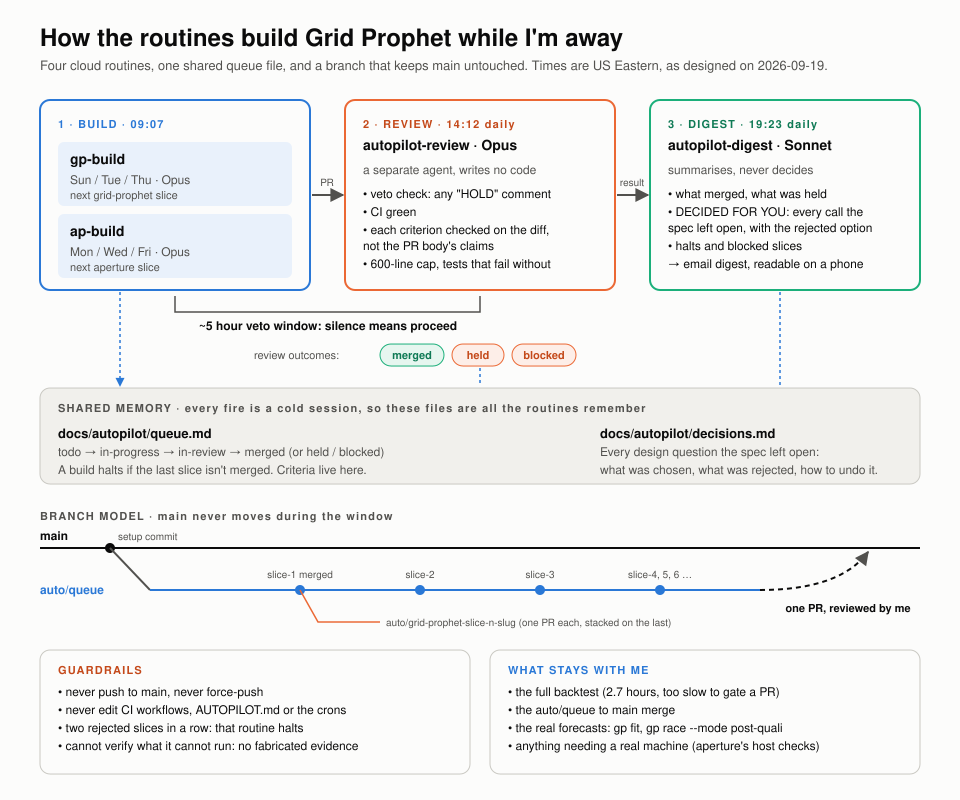
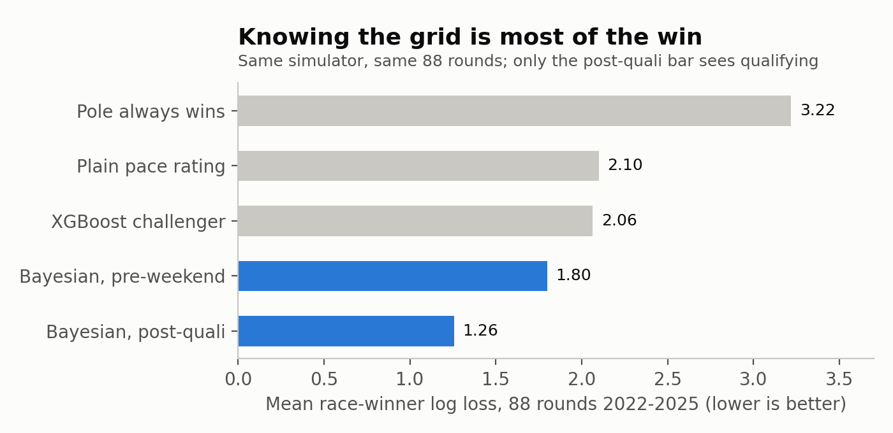
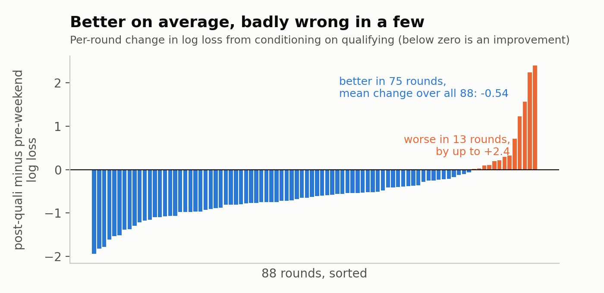
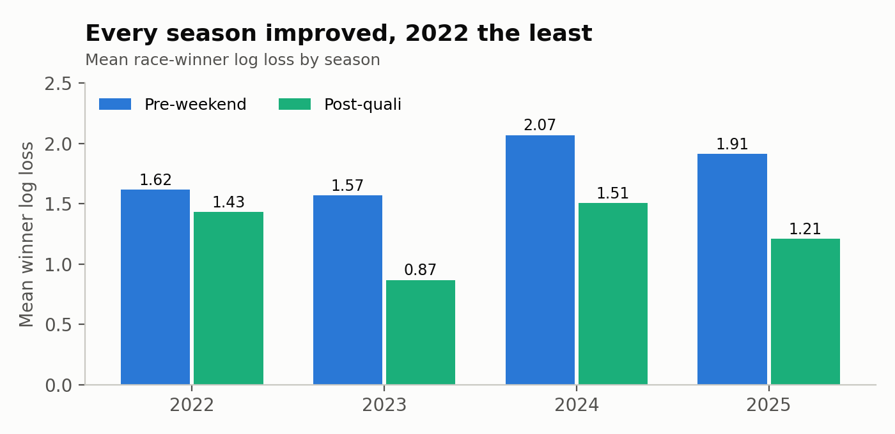
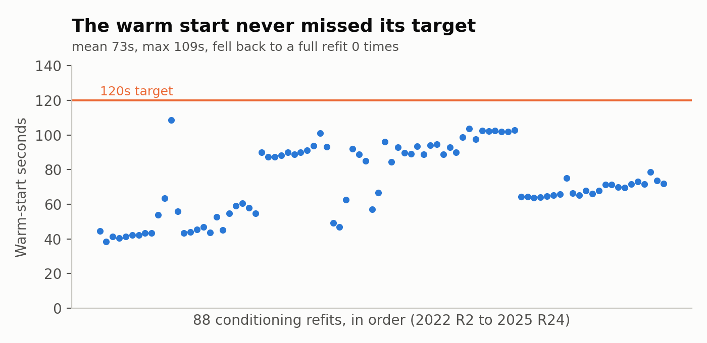
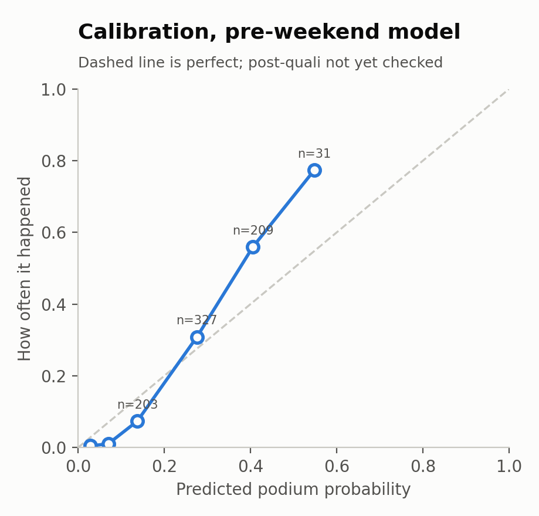

# I let routines rebuild my F1 model while I was away, then graded it on a race that hasn't happened yet

Oct 11, 2026 · [x] min read · Tags: Project, Ai

My first F1 predictions were two one-off repos, one for Monaco '25 and one for Hungary '25, each pulling lap times and driver history out of FastF1 and guessing a winner, and I posted them on LinkedIn with a promise that a more detailed writeup was coming. This is that writeup, a few months late, and since the project grew into something else in the meantime it also covers the rebuild, the routines that did a lot of the building, and the model's first prediction for a race that hasn't happened yet.

## Version one, and why I kept poking at it

Grid Prophet started in early April as a season-level model for the 2026 constructors' championship, which seemed worth trying in a year where the regulations changed and nobody knew who would be fast. It was XGBoost against Ridge on ~120 rows (one per constructor per season), with leave-one-season-out cross-validation, bootstrapped confidence intervals, and a variable for how teams usually behave in rule-change years. It worked well enough [the 0.88 score the new model has to beat -- confirm which metric], but it could only answer one question, which was who finishes where in the standings, and it had nothing to say about a single race.

## How it got picked again

I've been trying to keep a streak going of one meaningful commit a day across whatever side project needs it most, and the hard part is never the work, it's picking *which* project deserves the day. In August I had an agent audit all ~20 of my repos for TODOs, doc claims with no code behind them, and stale checklists, and grid-prophet came back with an untrained `--ensemble` model artifact. I ended up fixing a different repo that day (a trash classifier whose production function had been throwing on every request, because the local dev server and the deployed handler were two files that had quietly drifted apart), but the lesson from that one followed me back here, and I'll get to why.

## The rebuild

The second version is a hierarchical Bayesian pace model that works per driver per race, with a latent car pace that drifts over the season, a driver skill term with a prior for rookies, and a driver-by-circuit-type interaction, all simulated forward 50,000 times so that win, podium, points and finishing-position probabilities come out of one engine instead of three separate questions. Reliability is its own piece, split into mechanical failures per team and incident DNFs per driver, because an engine failure and a first-lap collision are not the same kind of bad luck.

Two things had to give along the way. The spec wanted NumPyro and LightGBM, but `jaxlib` refuses to import on my Windows setup and LightGBM segfaults as soon as pandas is loaded, so it runs on PyMC and XGBoost, and PyMC turned out to be faster than I expected with a full fit over 2018-2026 taking ~80 seconds. One assumption also didn't survive: I had assumed clean-air race pace would track qualifying gap at ~0.8 Spearman, and after filtering out every lap spent behind another car it came out at ~0.6, which I checked as a possible bug in my filter and it wasn't, that's just how the data is.

## The routines

While I was away for six days in late September I wanted the project to keep moving without me being the bottleneck, so I broke Phase 2 of the spec into six slices (post-quali conditioning, sprints, the reliability split, a fitted overtaking parameter per circuit, wet-race noise, and some carry-forwards) and set up four scheduled cloud routines, which are drawn below. Two build routines each take the next slice off a queue file and open a pull request, a separate review routine checks every acceptance criterion against the diff rather than the PR description, and a digest routine writes me a summary I can read on my phone.

The part I care about most is that `main` never moves, everything lands on a branch called `auto/queue`, and I review it as one pull request afterwards, so if it all went wrong I could delete a branch and lose nothing. Funnily enough the review routine earned its keep, because it blocked slice 1 outright since it couldn't run the acceptance criterion without real data, so I committed an 80-row fixture from 2024 and the review went through after that. It also caught that `gp fit` crashed on Python 3.12 (sampling worked, saving the result didn't, because a newer arviz stopped pulling in a netCDF backend), and that the overtaking fit could be deleted from both forecast call sites with every test still passing, which is the same disease as the trash classifier: everything looks green and the real path isn't being exercised. At one point two agents also wrote the same merge status within minutes of each other and I still don't know if the review cron fired twice.

## Does it work?

For the backtest I ran 88 rounds from 2022 to 2025, refitting before every round, which took 2.7 hours on one laptop, and FastF1 rate-limits you at 500 calls an hour so collecting the data meant a loop of re-run, wait 20 minutes, re-run. 2025 Miami also has no qualifying times upstream so I rebuilt that round by hand from the session laps.

The pre-weekend model beats all three baselines, and post-quali mode, where the model refits on the real qualifying session before forecasting, gets down to **1.258**. I will say that number deserves suspicion, because most of that gain is simply knowing the grid and the backtest can't separate that from anything clever the refit does.

It's better in 75 of 88 rounds and worse in 13, some of them badly (2022 Round 13 went from 1.51 to 3.90), and those are the rounds where the real grid pointed confidently at someone who then didn't win. The gain also isn't spread evenly, every season improved but 2022 barely moved.

The refit itself never became a problem. The warm start, which starts from the pre-weekend posterior instead of fitting from scratch, averaged ~73 seconds against a 120 second target and never once had to fall back to a full refit.

## Is this the best model I could have made?

No, and the clearest evidence is the calibration plot for the pre-weekend model, which I only made while writing this post.

When the model says a driver has a ~55% chance of a podium it happens ~77% of the time, and when it says ~3% it happens ~0.5% of the time, so it's too timid at the front and too generous at the back. I never checked calibration for the post-quali model at all, so I can't tell you which way it leans. I also never ran a slice-by-slice ablation, which means I can't say which of the six slices are earning their keep, the 0.54 improvement is one run with one seed per round and no confidence interval, and there's no Phase 3 yet (the drivers' and constructors' championship simulation), so the old model's 0.88 hasn't actually been compared against.

## Predictions for this weekend

This is the Singapore GP, round 17, and since it's a sprint weekend the sprint has already run, so this is only about Sunday. I refreshed the data, refit through round 16, and conditioned on qualifying with the warm-start refit, which took 47 seconds. The race grid normally comes from the race rows, which don't exist yet, so I added a flag that takes it straight from the qualifying classification, which means **grid penalties are not in here**.

- **Verstappen:** ~69% to win, ~86% for a podium, ~20.5 expected points
- **Leclerc:** ~19% to win, ~79% for a podium
- **Antonelli:** ~5% to win, ~55% for a podium
- **Hamilton:** ~4.5% to win, ~51% for a podium
- **Norris:** ~1% to win, ~13% for a podium

The part I find interesting is that Hamilton qualified ahead of Antonelli and the model still gives the Mercedes a slightly better shot at the podium, which is the model saying it rates the car more than the grid slot. Everyone from Alpine down is under 0.1% to win, and the DNF risk sits around 10% for most of the front, so the 17th in Verstappen's 90th percentile finish is just the chance that his race ends early.

(Note to self: on Monday, score this against the actual result and write down how wrong it was, since that's the post-quali calibration data I still don't have)
