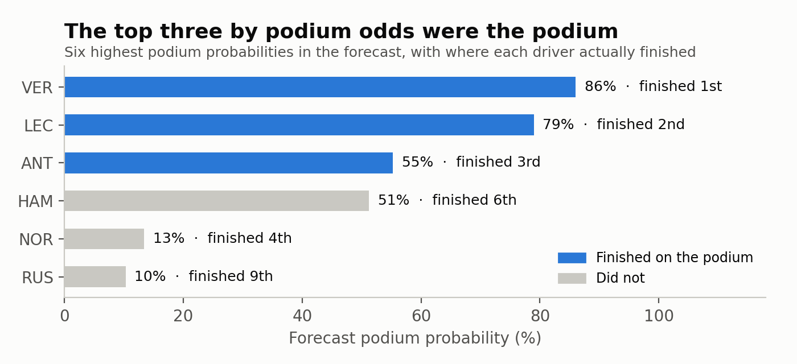
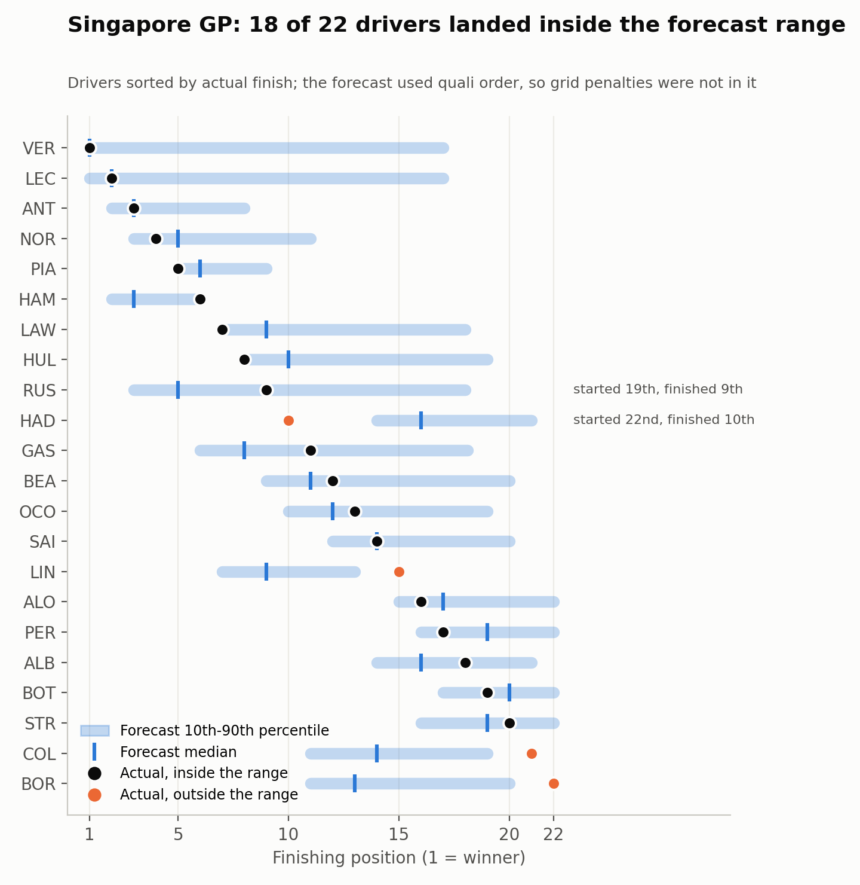

# I rebuilt my F1 model, let routines build out parts of it, and graded it on Singapore

**TL;DR**

- Backtest, 88 rounds from 2022 to 2025: knowing qualifying cut winner log loss[^1] from 1.801 to 1.258, mostly because knowing the grid helps.
- Singapore: winner log loss 0.376, and the model's top three podium odds (Verstappen, Leclerc, Antonelli) were the podium, in a race that was easy to call.
- What broke: the warm-start refit took 1,744 seconds against a 120 second target, and I don't know why yet.

## What that means

- The new model beat every baseline in a 2022-2025 backtest (winner log loss 1.80 pre-weekend, 1.26 with qualifying known), mostly because the grid is informative.
- On Singapore it called the podium and scored 0.376, but one easy race proves little.
- The refit that normally takes about a minute took 1,744 seconds, and the cause is still open.

I went away for six days in late September and left scheduled agents[^2] extending the next phase of my F1 prediction model. Since then I've scored it on the Singapore GP, and this post covers what worked, what the numbers do and don't prove, and the one thing that broke.

## Version one, and why I kept poking at it

Grid Prophet started in early April as a season-level model for the 2026 constructors' championship, which seemed worth trying in a year where the regulations changed and nobody knew who would be fast. It was XGBoost against Ridge on ~120 rows (one per constructor per season), with leave-one-season-out cross-validation, bootstrapped confidence intervals, and a variable for how teams usually behave in rule-change years. It worked well enough (Spearman[^3] ~0.88 on that leave-one-season-out CV, which is the number the new model eventually has to beat on season-level ranking), but it could only answer one question, which was who finishes where in the standings, and it had nothing to say about a single race.

## The rebuild

The second version is a hierarchical Bayesian pace model that works per driver per race, with a latent car pace that drifts over the season, a driver skill term with a prior for rookies, and a driver-by-circuit-type interaction, all simulated forward 50,000 times so that win, podium, points and finishing-position probabilities come out of one engine instead of three separate questions. Reliability is its own piece, split into mechanical failures per team and incident DNFs per driver, because an engine failure and a first-lap collision are not the same kind of bad luck.

Two things had to give along the way. The spec preferred NumPyro and LightGBM, but `jaxlib` refuses to import on my Windows setup and LightGBM segfaults as soon as pandas is loaded, so it runs on PyMC and XGBoost, and PyMC turned out to be faster than I expected with a full fit over 2018-2026 taking ~80 seconds. One assumption also didn't survive: I had assumed clean-air race pace would track qualifying gap at ~0.8 Spearman, and after filtering out every lap spent behind another car it came out at ~0.6, which I checked as a possible bug in my filter and it wasn't, that's just how the data is.

## The routines

Before I went away for six days in late September I wanted the project to keep moving without me being the bottleneck, so I broke Phase 2 of the spec into slices and set up four scheduled cloud routines, which are drawn below. Only the first three slices (post-quali conditioning, sprints, and the reliability split) were queued for that window, and the other three (a fitted overtaking parameter per circuit, wet-race noise, and some carry-forwards) were queued on October 1 once the queue ran dry. A build routine takes the next slice off a queue file and opens a pull request (one build routine for this repo and another for a different project of mine, aperture), a separate review routine checks every acceptance criterion against the diff rather than the PR description, and a digest routine writes me a summary I can read on my phone.

The part I care about most is that `main` never moves, everything lands on a branch called `auto/queue`, and I review it as one pull request afterwards, so if it all went wrong I could delete a branch and lose nothing. Funnily enough the review routine earned its keep, because it blocked slice 1 outright since it couldn't run the acceptance criterion without real data, so I committed an 80-row fixture from 2024 and the review went through after that. Somewhere along the way it also came out that `gp fit` crashed on Python 3.12 (sampling worked, saving the result didn't, because a newer arviz stopped pulling in a netCDF backend), and the review of the overtaking slice found that the overtaking fit could be deleted from both forecast call sites with every test still passing, which is the same disease I found in a trash classifier of mine, whose production handler was failing on every request while its local dev server, a separate file, worked fine: everything looks green and the real path isn't being exercised. Two agents once wrote the same merge status minutes apart, and I never found out whether the review cron fired twice.

## Does it work?

For the backtest I ran 88 rounds from 2022 to 2025, refitting before every round (every round except the first of each season, which is why it's 88 and not 92), which took 2.7 hours on one laptop, and FastF1 rate-limits you at 500 calls an hour so collecting the data meant a loop of re-run, wait 20 minutes, re-run. 2025 Miami also has no qualifying times upstream so I rebuilt that round by hand from the session laps.

The pre-weekend model beats all three baselines, and post-quali mode, where the model refits on the real qualifying session before forecasting, gets down to a winner log loss of **1.258**. I will say that number deserves suspicion, because most of that gain is simply knowing the grid and the backtest can't separate that from anything clever the refit does.

It's better in 75 of 88 rounds and worse in 13, some of them badly (2022 Round 13 went from 1.51 to 3.90), and those are the rounds where the real grid pointed confidently at someone who then didn't win. The gain also isn't spread evenly, every season improved but 2022 improved the least.

The refit itself never became a problem. The warm start, which starts from the pre-weekend posterior instead of fitting from scratch, averaged ~73 seconds against a 120 second target and never once had to fall back to a full refit.

## Is this the best model I could have made?

No, and the clearest evidence is the calibration plot for the pre-weekend model, which I only made while writing this post.

When the model says a driver has a ~55% chance of a podium it happens ~77% of the time (though that bin only has 27 driver-rounds in it, so treat the exact number loosely), and when it says ~3% it happens ~0.5% of the time across 564 driver-rounds, so it's too timid at the front and too generous at the back. I never checked calibration for the post-quali model at all, so I can't tell you which way it leans. I also never ran a slice-by-slice ablation, which means I can't say which of the six slices are earning their keep, the 0.54 improvement is one run with one seed per round and no confidence interval, and there's no Phase 3 yet (the drivers' and constructors' championship simulation), so the old model's 0.88 hasn't actually been compared against.

## The Singapore prediction

This was the Singapore GP, round 17, and since it was a sprint weekend the sprint had already run, so this is only about Sunday. Before the race I refreshed the data, refit through round 16, and conditioned on qualifying with the warm-start refit, which took 47 seconds. The race grid normally comes from the race rows, which don't exist yet, so I added a flag that takes it straight from the qualifying classification, which means **grid penalties are not in here**.

- **Verstappen:** ~69% to win, ~86% for a podium, ~20.5 expected points
- **Leclerc:** ~19% to win, ~79% for a podium
- **Antonelli:** ~5% to win, ~55% for a podium
- **Hamilton:** ~4.5% to win, ~51% for a podium
- **Norris:** ~1% to win, ~13% for a podium

The part I find interesting is that Hamilton qualified ahead of Antonelli and the model still gives Antonelli a slightly better shot at the podium. Everyone from Alpine down is under 0.1% to win, and the DNF risk sits around 10% for most of the front, which is why Verstappen's forecast range runs all the way down to 17th. A percentile is just a cut-off in the simulations: in 90% of the 50,000 simulated races he finishes 17th or better, so the worst 10% sit beyond that, and a retirement counts as a back-of-the-field result, so that tail lines up with his chance of not finishing. In other words the 17th is the DNF tail, not a forecast that he'd be slow.

## What actually happened

Verstappen won from pole, Leclerc was second and Antonelli third, which is exactly the top three in the model's podium odds (86%, 79% and 55%), and Hamilton, the fourth name on that list at 51%, finished sixth.

Scored the same way as the backtest, the winner log loss came out at 0.376 against the backtest's post-quali average of 1.258 (better than 95% of those 88 rounds) and the Spearman against the real finishing order was 0.86 against 0.66, which sounds great until you notice that the pole-wins baseline scored 0.001 on this race and beat the model, because the pole-sitter won. A race where the favorite wins is the easiest kind to call, so I'm treating it as a good sign and not as evidence about calibration.

18 of the 22 drivers landed inside their forecast range, against ~17.6 you'd expect from an 80% range, and the four outside it were Hadjar (started from the pit lane, finished 10th), Lindblad (forecast 9th, finished 15th), and Colapinto and Bortoleto (forecast ~13th to 14th, both retired and not classified). The starting grid was the other thing I knew would go wrong, because the forecast used the qualifying order and Russell took an engine penalty and started 19th instead of 6th (he finished 9th, which the forecast, expecting him around 5th, had comfortably inside its range).

To see how much that mattered I re-ran the forecast from the real starting grid, and the answer was annoying: the winner log loss and podium Brier[^4] barely moved (0.375 and 0.025), but the points Brier got worse (0.123 to 0.180) and the Spearman dropped from 0.86 to 0.81, because with Russell starting 19th the model put him ~14th and he finished 9th. So ignoring the penalty happened to score better on this race, which is luck and not a reason to prefer the qualifying order.

That re-run also hit the first warm-start failure I've seen. The warm-start refit took 1,744 seconds (~29 minutes) before it fell back to a full refit that took another 68, against a 120 second target and against 47 seconds for the pre-race run on the same model, and I haven't found out why yet. The spec treats a late-season miss as a real regression and not an accepted exception, so that's the first thing to look at, and until I do the "zero fallbacks in 88 rounds" line from the backtest is true but is not the whole story.

## Where this leaves it

Three things I'd keep from this. Green tests prove the code you tested and nothing else, and both the trash classifier and the overtaking fit looked fine until someone checked the path that actually runs. Most of the post-quali gain is simply knowing the grid, so the 1.258 says less about the model than it appears to. And one race, even one the model called well, tells you almost nothing about calibration, which is why Singapore is a good sign and not a result.

What's next is a short list: work out why that warm start took half an hour, add Singapore to the post-quali calibration check, run a slice-by-slice ablation to see which of the six slices are earning their keep, and then build Phase 3, the drivers' and constructors' championship simulation, which is where the old model's 0.88 finally gets a fair comparison. I'll write up whatever breaks first. If you want to follow along, subscribe here or find me on X at @memeerav.

[^1]: Winner log loss is a score for how much probability the model gave the driver who actually won, where lower is better (for Singapore, ~69% on the winner scored 0.376).
[^2]: These are the "routines" in the title: scheduled cloud agents, meaning AI jobs that start on a timer on someone else's machine and each do one job, like building a slice or reviewing a pull request.
[^3]: Spearman is a score from -1 to 1 for how closely a predicted order matches the real one, where 1 is identical.
[^4]: The Brier score is the average squared gap between a forecast probability and what happened (counted as 1 or 0), so lower is better and 0 would be perfect.
