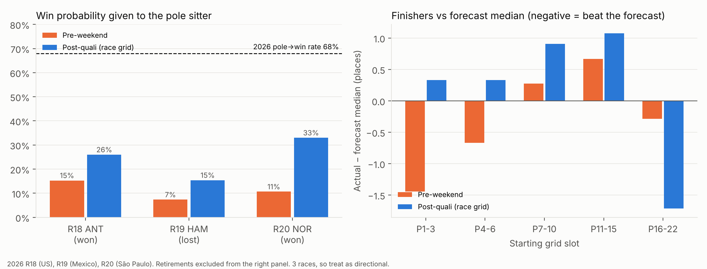

# Weekly model review: 2026-11-11

**Race weekend check: no.** São Paulo (R20) ran Nov 6–8 and Las Vegas (R21) is
Nov 19–21, so Nov 13–15 is a gap. This run reviewed forecasts against results
and did not refresh the forecast.

## What was compared

There were three races (R18 US, R19 Mexico, R20 São Paulo), each with three
v2 forecast arms from the `forecast-data` branch:

- **pre-weekend:** before quali.
- **post-quali:** grid taken from the quali order.
- **post-quali (race grid):** the actual starting grid, with penalties.

That gives 22 drivers × 3 races per arm. Actuals come from
`data/driver_rounds.csv` on the same branch. The scoring scripts are not
committed. The numbers can be rebuilt from the `outputs/*/score_2026_*.csv`
files and the race forecast CSVs.

**Sample caveat:** three races is a small sample. Read everything below as
directional, and only act on it once the backtest confirms it (CLAUDE.md rule).

## Headline numbers

| Arm | Winner log loss (mean of 3) | 80% band coverage | Mean abs. error vs expected position |
|---|---|---|---|
| Pre-weekend | 1.83 | 97% | 2.92 |
| Post-quali (quali grid) | 1.36 | 89% | 2.60 |
| Post-quali (race grid) | 1.32 | 88% | 2.67 |

These numbers line up with the Phase 2 backtest (post-quali 1.258, pre-weekend
1.801). Quali conditioning is still worth about 0.5 nats. Nothing here looks
like a regression.

## Findings

1. **The pole sitter is underweighted.** The pole sitter won two of three
   races (ANT at R18, NOR at R20), and pole converts 68% of the time in 2026
   (67% in 2025). The post-quali model gave the pole sitter 26%, 15% and 33%,
   and in none of the three races was the pole sitter the outright favourite.
   VER from P2 and from P5 got more weight. A naive "68% to the pole sitter,
   rest spread ∝ 1/grid" rule would score about 1.5 winner log loss on these
   three races, close to the model's 1.32–1.36 with no pace model at all.
2. **Recovery from the back is underestimated.** Finishers who started P16–22
   ended 1.7 places better than the race-grid forecast median, and only 64%
   landed inside the 80% band. Examples: VER P21→P2 (band P3–P19), LAW P22→P7,
   HAM P20→P9, STR P22→P15. Across finishers, a regression of actual places
   gained on forecast places gained has slope 1.17.
3. **Findings 1 and 2 have one cause.** In `src/sim/race.py:135` the grid
   penalty is linear: each slot costs the same time, P1→P2 the same as
   P20→P21. In reality the front of the grid is worth much more (clean air,
   first into Turn 1), while the back is a congested field that a fast car
   cuts through cheaply. A linear penalty is tuned to the average slot, so it
   is too weak at the front and too strong at the back.
4. **Pre-weekend bands are too wide and too timid at the front.** Coverage is
   97% and 100% at R19/R20 against an 80% target. Finishers who started P1–3
   finished 1.4 places ahead of the pre-weekend median. This matches the
   Phase 2 calibration note.
5. **The penalty grid matters, but it can't be fed in after the fact.** At R20
   the official penalty grid cut winner log loss from 1.44 to 1.11. At R19,
   reading the grid from the race rows made the forecast worse (1.29 → 1.51),
   because LAW's pit-lane start went in as P22 and he then finished P7.
   `--grid-file` (added Nov 8) is the right tool, as long as it's run after
   the FIA publishes the grid.
6. **The team pace prior lags.** Among finishers on the race grid, Aston
   Martin beat the forecast median by 3.0 places and Racing Bulls by 2.2,
   while Alpine (+2.4) and Haas (+2.3) finished behind it. The R19 and R20
   fits had no race-pace rows for R18–R19, because F1 live timing returns 401
   and FastF1 has no laps for them. Those rows are now backfilled from jolpica
   (R18 22, R19 21, R20 21 drivers with clean-air pace), so the R21 fit will be
   the first to see them.
7. **DNF totals are fine, but the model can't tell which drivers will
   retire.** It forecast 9.0 retirements over the three races against 10
   actual. Mean p_dnf was 0.18 for drivers who retired and 0.13 for those who
   finished. One cause: since 2023, every retirement comes in as `Retired` /
   `dnf_cause=other` (0 mechanical and 0 incident labels in 2024–2026). The
   reliability split is therefore learning from 2018–2022 labels only.

## Options

| # | Change | Fixes | Effort | How to implement |
|---|---|---|---|---|
| A | **Front-loaded grid penalty** | 1, 2, 3 | Medium | In `src/sim/race.py`, replace `penalty_per_slot * (grid - 1)` with a concave curve, e.g. `penalty * k * log1p((grid-1)/k)` or a separate pole/front-row bonus. Refit `model/overtaking.py` with the same functional form, since its units are tied to `GRID_LOCK_BASE_PENALTY_S`. Add a unit test that P1 vs P2 costs more than P20 vs P21. Then run the post-quali backtest and compare winner log loss and the P16–22 band coverage. |
| B | **Pole-rate calibration check (cheap diagnostic, do first)** | 1 | Low | Over the existing backtest outputs, compare mean `p_win` for the pole sitter with the empirical pole→win rate per season. If the gap shows up across 2022–2025 and not only in these three races, A is justified. No refit needed: just a pandas script over `conditioning_log.csv` and the per-round forecasts. |
| C | **Heavier-tailed race noise for out-of-position starters** | 2 | Low–Medium | Widen the per-trial race-pace noise, or add a pace-vs-grid-mismatch term, when the grid differs from quali by more than about 5 places (penalties, pit-lane starts). This is a smaller change than A if B says the front of the grid is fine. |
| D | **Temperature-scale pre-weekend probabilities** | 4 | Low | Fit one sharpening temperature on 2022–2025 backtest outputs (the slice-10 post-quali calibration is the model for this) and apply it in `cli race --mode pre`. Target 80% band coverage of about 0.80. |
| E | **Make `--grid-file` part of the race-week routine** | 5 | Low | Have `scripts/weekend_forecast.sh` (on `claude/beautiful-cerf-p55i9t`) take an optional grid file and run Sunday morning after the FIA grid is posted. Keep the quali-order run as the Saturday forecast. Do not reconstruct pit-lane starts as P22 from race rows. |
| F | **Recency weight on team pace** | 6 | Medium | Give 2026 rounds a time-decay weight (or a round-level random walk on team pace) in `src/model/pace.py`, so late-season upgrades show up within one or two rounds. Backtest-gated. |
| G | **Recover DNF causes for 2023+** | 7 | Medium (data work) | Map `Retired` rows to mechanical or incident from jolpica's status text or race reports. Or add a heuristic: lap-1 retirement or multi-car same-lap → incident, otherwise mechanical. Store the result in `dnf_status_map.csv` or a per-row override CSV. Re-run the slice-3 tests. |

**Recommended order:** run B first, since it's an afternoon and decides
whether A is worth it. Do E before Las Vegas (it's cheap and pays off
directly). Then A, or C if B shows the front is fine, as one backtest-gated
slice. D and F are next. G is worthwhile but slow.

None of A, C, D or F is proven by this review. Each one needs the owner-run
backtest (`gp backtest --seasons 2022-2025 --rounds all --method nuts
--post-quali`) before merging.
